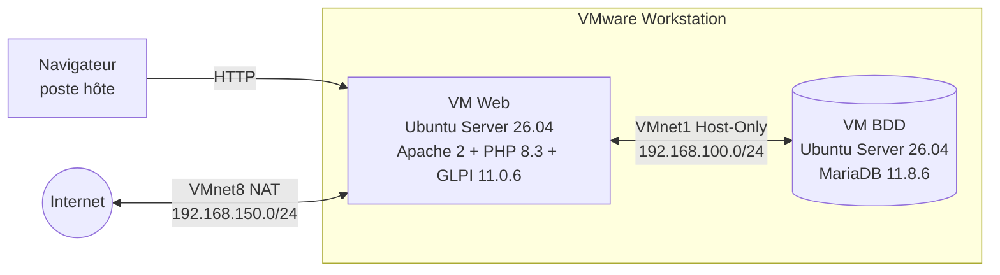
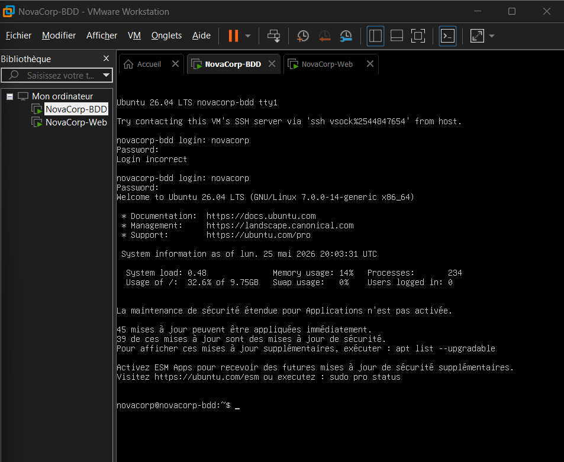
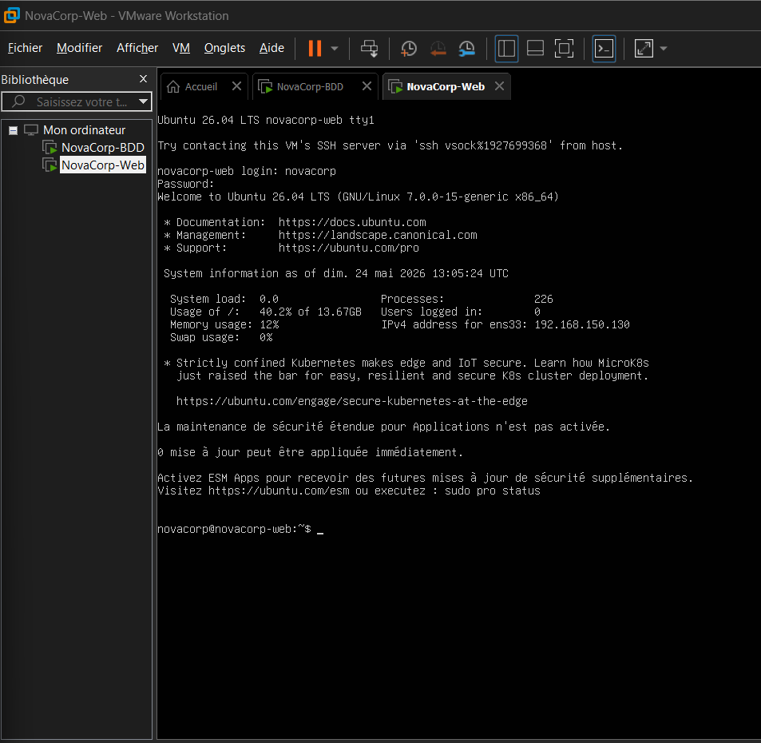
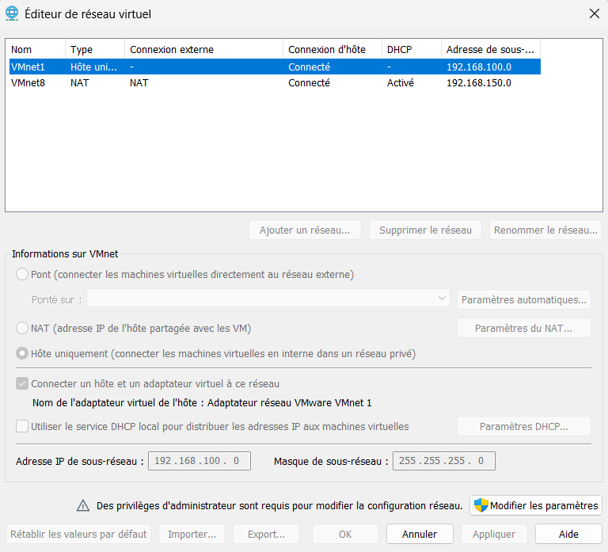
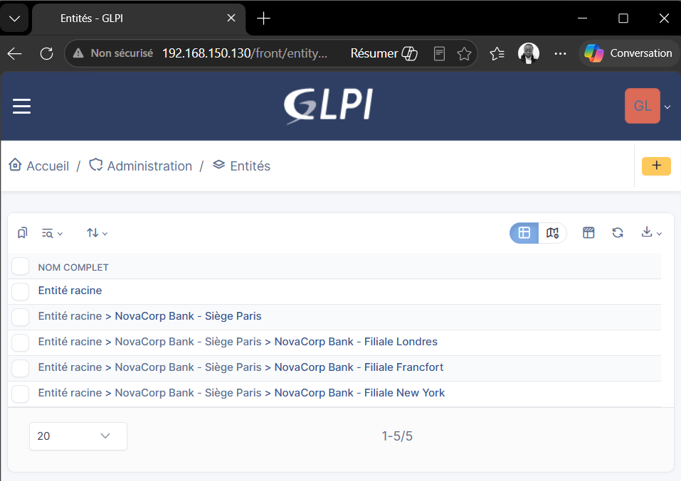
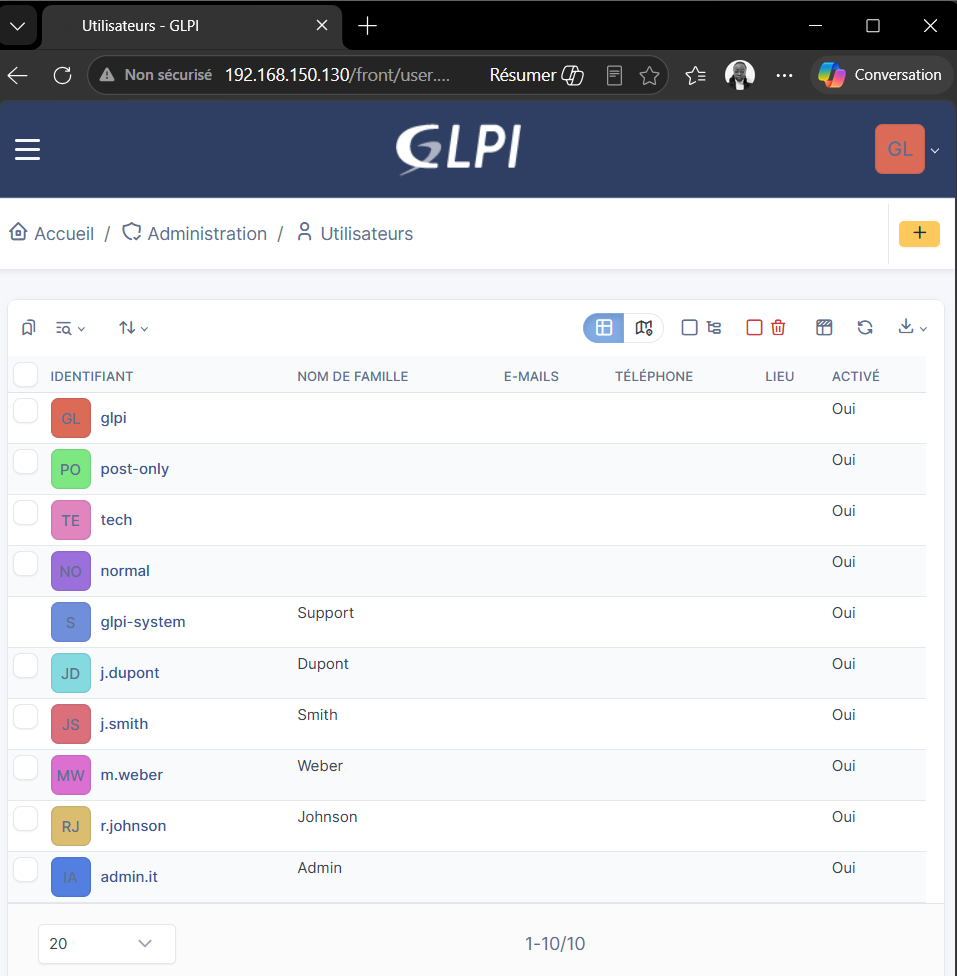
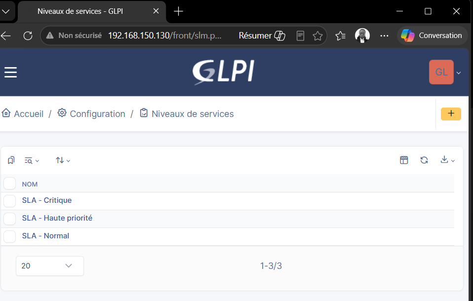
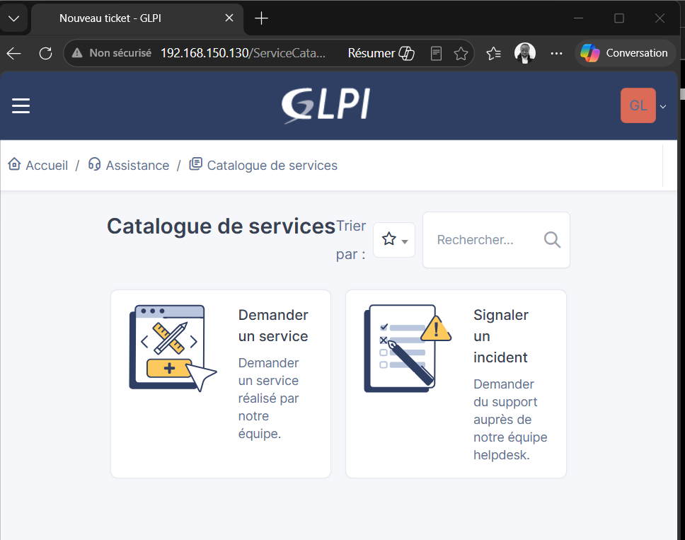
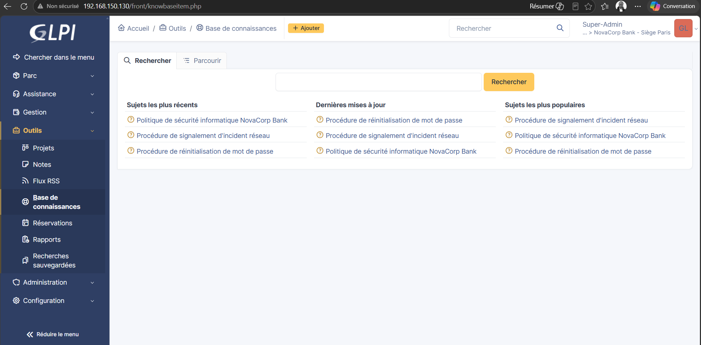

# NovaCorp Bank : déploiement d'une infrastructure ITSM avec GLPI

Projet scolaire ESGI Paris (Bachelor Informatique 1re année), module **Virtualisation et Gestion de Parcs Informatiques**.
Soutenance le 26 mai 2026.

> NovaCorp Bank est une entreprise fictive. Le projet a tourné en local sur deux machines virtuelles VMware : ce dépôt documente l'architecture, la configuration et le résultat, avec des captures d'écran. Aucun mot de passe ni fichier de VM n'est publié.

## Contexte

NovaCorp Bank est une banque de détail et de gestion de patrimoine : siège à Paris, filiales à Londres, Francfort et New York, environ 10 000 collaborateurs.

**Objectif** : concevoir une infrastructure ITSM complète pour
- centraliser la gestion du parc matériel,
- gérer les demandes d'assistance des collaborateurs,
- structurer une base de connaissances.

**Solution retenue** : GLPI 11.0.6 sur une infrastructure virtualisée VMware Workstation (25H2).

## Architecture



La base de données n'est jamais exposée à Internet : seule la VM Web peut la joindre, par le réseau interne Host-Only. C'est le choix de sécurité central du projet, adapté à un contexte bancaire.

### Machines virtuelles

| VM | OS | RAM | CPU | Disque | Rôle | Réseau |
|---|---|---|---|---|---|---|
| Serveur Web | Ubuntu Server 26.04 LTS | 4 Go | 2 vCPU | 30 Go | Apache 2 + PHP + GLPI 11.0.6 | VMnet8 (NAT) + VMnet1 (Host-Only) |
| Base de données | Ubuntu Server 26.04 LTS | 4 Go | 1 vCPU | 20 Go | MariaDB 11.8.6 | VMnet1 (Host-Only) uniquement |

### Réseau VMware

| Réseau | Type | Sous-réseau | Adressage | Interfaces |
|---|---|---|---|---|
| VMnet8 | NAT | 192.168.150.0/24 | DHCP (mises à jour, téléchargements) | VM Web `ens33` |
| VMnet1 | Host-Only | 192.168.100.0/24 | IP fixes, DHCP désactivé | VM Web `ens34`, VM BDD `ens33` |

### Pile logicielle (LAMP répartie sur 2 VM)

- **Ubuntu Server 26.04 LTS**
- **Apache 2** avec `mod_rewrite`
- **PHP 8.3+** avec les extensions mysql, curl, gd, intl, mbstring, xml, zip
- **MariaDB 11.8.6** sur la VM dédiée : base `glpi`, utilisateur `glpi_user`
- **GLPI 11.0.6**, accessible depuis le navigateur de l'hôte

Les étapes d'installation sont décrites dans [docs/installation.md](docs/installation.md), et des exemples de fichiers de configuration (sans secrets) sont dans [config/](config/).

## Gouvernance GLPI

### Entités

```
Entité racine
└── NovaCorp Bank – Siège Paris
    ├── Filiale Londres
    ├── Filiale Francfort
    └── Filiale New York
```

Chaque filiale est une entité GLPI indépendante : tickets, matériel et droits sont cloisonnés. Un technicien de Londres ne voit que les données de son entité.

### Utilisateurs, groupes et profil personnalisé

4 entités, 5 utilisateurs, 4 groupes, et un profil créé pour le projet : **Technicien Filiale**.

| Droit | Technicien Filiale |
|---|---|
| Voir, créer et mettre à jour les tickets de son entité | Oui |
| Voir les tickets de son groupe, assigner, être en charge | Oui |
| Parc matériel (ordinateurs, moniteurs, réseau) | Lecture seule |
| Configuration globale, autres entités, administration | Aucun accès |

## Inventaire et niveaux de service

**Gabarits** : poste de travail standard, serveur.

**Cycle de vie du matériel** : En stock → En service → En maintenance → Hors service → Mis au rebut.

| SLA | Délai de résolution (TTR) | Escalade |
|---|---|---|
| Critique | 4 h | à 2 h |
| Haute priorité | 8 h | à 4 h |
| Normal | 24 h | à 12 h |

## Assistance et base de connaissances

**Formulaires** (catalogue de services)
- *Signaler un incident* : urgence, description, pièce jointe
- *Demander un service* : demande au catalogue NovaCorp Bank

**Base de connaissances**
- Procédure de réinitialisation de mot de passe
- Procédure de signalement d'un incident réseau
- Politique de sécurité informatique NovaCorp Bank

**Cycle d'un ticket**


## Captures d'écran

| | |
|---|---|
|  VM BDD |  VM Web |
|  Éditeur de réseau virtuel |  Entités GLPI |
|  Utilisateurs |  Niveaux de service |
|  Catalogue de services |  Base de connaissances |

Toutes les captures sont dans [captures/](captures/), et le support de soutenance complet est dans [docs/NovaCorp_Bank_ITSM_Soutenance.pdf](docs/NovaCorp_Bank_ITSM_Soutenance.pdf).

## Compétences mobilisées

Virtualisation (VMware Workstation), segmentation réseau (NAT / Host-Only, IP fixes), administration Linux (Ubuntu Server), pile LAMP, MariaDB (base et utilisateur dédiés, accès distant restreint), ITSM avec GLPI (entités, profils et droits, gabarits d'inventaire, SLA, catalogue de services, base de connaissances).

## Équipe

- DJOUEGOUO ESSOME Ivonne Ange
- MOREAU Armel
- BAKARI GANDO Mouami Amoi
